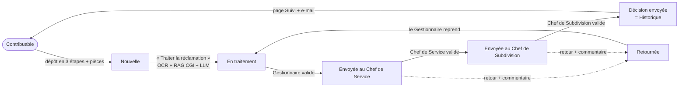

# GEIF — Gestion Électronique Intelligente des Flux fiscaux

Projet de fin d'année (PFA), 2ᵉ année Data & Software Sciences — **ENSIAS**.
Stage : Direction Régionale des Impôts (DRI) de Rabat, Subdivision Fiscalité des Personnes Morales (DGI, Maroc).

GEIF traite les **réclamations fiscales** (IS, IR, TVA) de bout en bout : dépôt en ligne par le contribuable, lecture des pièces (OCR),
recherche des articles du **Code Général des Impôts** (RAG), rédaction assistée du rapport d'instruction et de la décision (LLM),
validation hiérarchique, notification de la décision et pilotage statistique.

> ⚠️ **Prototype académique.** Aucune donnée fiscale réelle n'est utilisée. Les décisions proposées par le modèle de langage sont des
> **aides à la décision** : chaque dossier est relu, modifiable et validé par trois niveaux d'agents.

## Workflow



| Rôle | Ce qu'il fait |
|---|---|
| **Contribuable** (sans compte) | Dépose sa réclamation (informations, pièces), reçoit une **référence** et un **code secret**, suit l'avancement, lit la décision, interroge l'assistant fiscal |
| **Gestionnaire** | Traite : relit les champs extraits des pièces, les articles du CGI et le texte généré, le modifie, puis l'envoie |
| **Chef de Service** | Lit les pièces, valide ou **retourne** (commentaire obligatoire) |
| **Chef de Subdivision** | Validation finale : la décision part au contribuable et le dossier passe dans l'**Historique** |

Les trois rôles accèdent à l'Accueil (leur file d'attente), l'Historique (recherche complète), le Dashboard, les Prévisions,
la Base de connaissances et les données AMMC.

## Démarrage rapide (Docker)

Prérequis : Docker Desktop. Première construction : plusieurs minutes (PyTorch CPU + modèle de recherche), ensuite quelques secondes.

```bash
cp .env.example .env          # Windows : copy .env.example .env
# renseigner dans .env : JWT_SECRET, CODE_CHEF_SERVICE, CODE_CHEF_SUBDIVISION (et GROQ_API_KEY pour le texte généré par le LLM)
docker compose up --build
```

| Service | Adresse |
|---|---|
| Portail contribuable + espace agents | http://localhost:8080 |
| API (documentation interactive) | http://localhost:8010/docs |
| E-mails de test (Mailpit) | http://localhost:8025 |

Données de démonstration (9 réclamations fictives et 3 comptes `demo_gestionnaire`, `demo_chef_service`, `demo_chef_subdivision`, mot de passe `Demo2026!`) :

```bash
docker compose exec api python seed_demo.py
```
> Supprimer les comptes `demo_*` avant tout usage réel (mot de passe public).

## Développement local (sans Docker pour l'API)

```bash
docker compose up -d mongo                      # base de données seule
cd backend
python -m venv .venv && source .venv/bin/activate   # Windows : .venv\Scripts\activate
pip install -r requirements-dev.txt
cp .env.example .env                            # puis le remplir (JWT_SECRET, codes chefs, GROQ_API_KEY…)
python -m app.ocr                               # diagnostic Tesseract (installer le français et l'arabe)
uvicorn main:app --port 8010 --reload
```
Frontend (autre terminal) : `cd frontend && python serve.py` → http://localhost:8080
(`serve.py` désactive le cache et refuse de démarrer si le port est déjà pris).

## Configuration (variables d'environnement)

| Variable | Rôle |
|---|---|
| `JWT_SECRET` | Signature des connexions (sans elle : clé temporaire, sessions perdues au redémarrage) |
| `GROQ_API_KEY`, `GROQ_MODEL` | Modèle de langage (texte du dossier, assistant). Sans clé : texte de repli fondé sur les règles |
| `CODE_GESTIONNAIRE`, `CODE_CHEF_SERVICE`, `CODE_CHEF_SUBDIVISION` | Codes d'inscription par rôle. **Vide pour un chef = inscription désactivée** |
| `SMTP_HOST`, `SMTP_PORT`, `SMTP_USER`, `SMTP_PASSWORD`, `SMTP_FROM` | E-mails (port 465 = SSL, sinon STARTTLS si proposé). Avec Docker : Mailpit par défaut |
| `OCR_LANGS`, `TESSERACT_CMD`, `TESSDATA_LOCAL`, `OCR_FORCER` | OCR (repli automatique si une langue manque ; `python -m app.ocr` pour diagnostiquer) |
| `MONGO_URI`, `MONGO_DB_NAME` | Base de données |
| `ALLOWED_ORIGINS` | Origines autorisées du frontend (CORS) |

## Architecture

| Couche | Technologie |
|---|---|
| Frontend | HTML/JS (ES modules) + CSS maison, Chart.js (local) — aucun build, servi par nginx |
| API | FastAPI, JWT + bcrypt, contrôle d'accès par rôle, limitation de débit |
| Données | MongoDB |
| OCR | Tesseract (français + arabe) ; PyMuPDF pour les PDF (couche texte lue directement, scans passés à l'OCR) |
| RAG | ChromaDB + `paraphrase-multilingual-MiniLM-L12-v2` sur le CGI (`rag/`) |
| LLM | Groq (rapport d'instruction, décision, reformulation, assistant du portail) |
| Apprentissage | Moteur bayésien (Beta-Bernoulli) qui apprend de l'accueil réservé par les gestionnaires aux propositions |
| Prévisions | Tendance linéaire (charge réelle) + baseline saisonnier / SARIMAX sur série **simulée** (`time_series/`) |

```
backend/        API FastAPI (app/routers, workflow, ocr, rag, llm, marche, saisonnalite) et tests
frontend/       portail/ (contribuable) · app/ (agents) · assets/ (design system, JS partagé, Chart.js)
rag/            indexation du CGI (ChromaDB) — ingest_pdfs.py
market_data/    scraper AMMC et fichiers collectés
time_series/    modèles de prévision (baseline saisonnier, SARIMAX)
data/generators/  générateurs de données synthétiques
scripts/        contrôles du frontend (CI)
```
Dossiers hérités du PFA initial, non branchés sur le circuit des réclamations : `ml_classification/` (classification de documents),
`deep_learning/` (CNN de mise en page), `data_engineering/` (DuckDB, Prefect), `cv_ocr/`, `devops/` (Superset).

## Tests

```bash
cd backend && python -m pytest tests -q          # circuit complet, sécurité, OCR, RAG, AMMC, prévisions… (MongoDB simulé, sans réseau)
python scripts/check_frontend.py                 # pages, imports, menu, ordre d'initialisation, syntaxe
```
La CI GitHub exécute ces contrôles à chaque push.

## Sécurité

Mots de passe hachés (bcrypt) · JWT à durée limitée · accès par rôle vérifié côté serveur à chaque action · le **code de suivi** du contribuable
n'est jamais affiché hors de sa page de confirmation et n'est jamais mis dans une adresse · limitation de débit (connexion, dépôt, suivi,
assistant) · données saisies jamais insérées en HTML (pas d'injection) · aucune clé dans le code (`.env` ignoré par git).

## Limites assumées

- **Données synthétiques uniquement** : aucune donnée de contribuable réel.
- **Prévisions** : la charge réelle est estimée sur peu d'historique (fiabilité affichée) ; la saisonnalité repose sur une **série simulée**,
  l'historique réel de la DGI n'étant pas disponible.
- **Données AMMC** : l'extraction automatique des PDF est **partielle** (statut affiché ligne par ligne : validé / partiel / non extrait) ; elles
  servent de repère sectoriel et **ne décident pas** des réclamations.
- **Modèle de langage** : peut se tromper ; sa sortie est toujours relue et modifiable, jamais appliquée seule.
- **RAG** : la pertinence est évaluée par un score simple ; une pertinence faible est signalée à l'agent.
- **Messagerie contribuable ↔ gestionnaire** : le code serveur existe (`backend/app/routers/messages.py`) mais n'est pas exposé dans la nouvelle interface.
